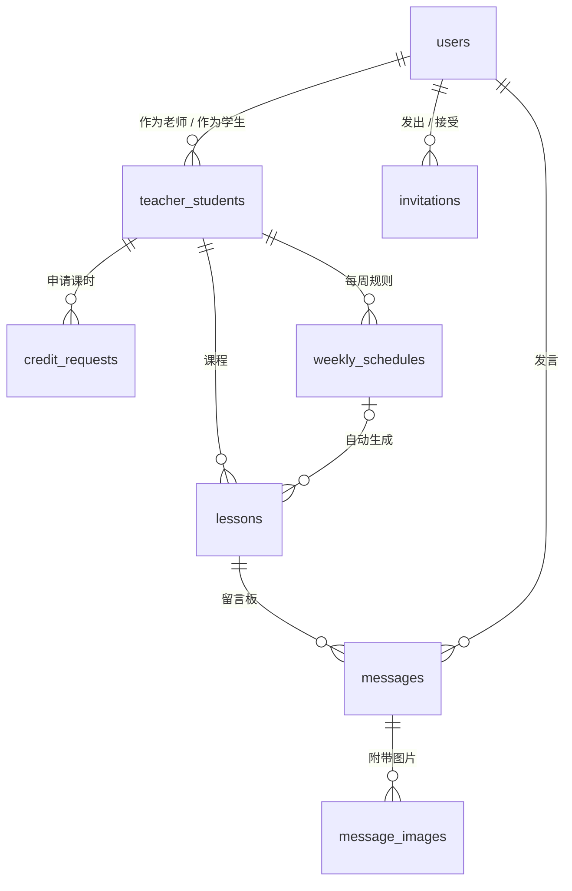

# 数据库设计（初稿）

- 更新日期：2026-11-02
- 依据：[需求文档](requirements.md) 第 3 版
- 状态：已确认。写施工方案时做了 3 处小调整（`lessons.rescheduled_to_id`、留言类型 `reschedule`、`lessons` 的唯一索引），理由见 [施工方案](implementation-plan.md) 第 3.6 节。

## 1. 总览

| 表名               | 中文名       | 内容                               |
| ------------------ | ------------ | ---------------------------------- |
| `users`            | 用户         | 通过 LINE 登录的人。已有，需要修改 |
| `teacher_students` | 师生关系     | 哪位老师和哪个学生关联             |
| `invitations`      | 邀请         | 邀请码及其使用情况                 |
| `credit_requests`  | 课时申请     | 学生申请增加课时，老师确认或拒绝   |
| `weekly_schedules` | 每周课程规则 | 每周几、几点上课                   |
| `lessons`          | 课程         | 每一节课                           |
| `messages`         | 留言         | 每节课下面的留言                   |
| `message_images`   | 留言图片     | 留言附带的图片（文件本身存在 R2）  |

关联关系的要点：

- 老师和学生之间是多对多，通过 `teacher_students` 连接。
- 课时申请、每周课程规则、课程都挂在「师生关系」上，而不是直接挂在老师或学生上。这样「某个学生和某位老师之间的课时、课程」就能直接查到。
- 留言挂在「课程」上，每节课一个留言板。

## 2. 通用约定

沿用现有的写法：

- 主键 `id`：自增整数。
- 时间：以 UTC 毫秒保存，显示时按查看者手机的时区换算。
- 每张表都有 `created_at`（创建时间）和 `updated_at`（更新时间），后文的表中省略不写。
- 代码中用驼峰命名，数据库列名自动转为下划线命名。

另外：

- **排课用的时区固定为日本时间（Asia/Tokyo）。**「每周一 13:00」「每月最后一天」都按日本时间计算。日本没有夏令时，换算不会出错。
- 数据量很小，**课时数、已上节数等统计值不保存在表中，每次查询时计算**（见第 4 节）。不会出现统计值与实际数据对不上的问题。
- 文字长度的上限（名字 50 字等）由后端的输入校验检查，数据库本身不限制。

## 3. 各表的字段

### 3.1 `users` 用户（修改现有的表）

| 字段                | 类型 | 必填 | 说明                                                                                           |
| ------------------- | ---- | ---- | ---------------------------------------------------------------------------------------------- |
| `id`                | 整数 | ✓    | 主键                                                                                           |
| `line_user_id`      | 文本 | ✓    | LINE 的 userId（以 U 开头），唯一                                                              |
| `line_display_name` | 文本 | ✓    | LINE 昵称，每次打开时同步。取不到时为空字符串。现有的 `display_name` 改名而来                  |
| `picture_url`       | 文本 |      | LINE 头像网址，每次打开时同步                                                                  |
| `name`              | 文本 |      | 首次设置时填写的名字（1～50 字），默认填入 LINE 昵称。画面上显示这个名字。未完成首次设置时为空 |
| `introduction`      | 文本 |      | 自我介绍（最多 1000 字）                                                                       |
| `role`              | 枚举 |      | `teacher`（老师）/ `student`（学生）。未完成首次设置时为空                                     |
| `is_admin`          | 真假 | ✓    | 是否管理员，默认否。只能直接修改数据库                                                         |

- `role` 和 `name` 都不为空，表示首次设置已完成。
- LINE 昵称和用户自己填写的名字分开保存：每次打开时同步 LINE 昵称，不会覆盖用户填写的名字。

### 3.2 `teacher_students` 师生关系

| 字段         | 类型 | 必填 | 说明              |
| ------------ | ---- | ---- | ----------------- |
| `id`         | 整数 | ✓    | 主键              |
| `teacher_id` | 整数 | ✓    | 老师 → `users.id` |
| `student_id` | 整数 | ✓    | 学生 → `users.id` |

- `teacher_id` 和 `student_id` 的组合唯一，同一对师生只能关联一次。
- 建立关联时，后端检查 `teacher_id` 的用户是老师、`student_id` 的用户是学生。

### 3.3 `invitations` 邀请

| 字段             | 类型 | 必填 | 说明                                                         |
| ---------------- | ---- | ---- | ------------------------------------------------------------ |
| `id`             | 整数 | ✓    | 主键                                                         |
| `code`           | 文本 | ✓    | 邀请码，唯一。随机生成的 22 位字符，放在邀请链接中，无法猜到 |
| `inviter_id`     | 整数 | ✓    | 邀请人 → `users.id`                                          |
| `expires_at`     | 时间 | ✓    | 有效期限（创建后 7 天）                                      |
| `accepted_by_id` | 整数 |      | 接受邀请的人 → `users.id`。为空表示还没被使用                |
| `accepted_at`    | 时间 |      | 接受时间                                                     |

- 邀请人的身份看 `users.role`，被邀请人必须是相反的身份。
- 接受邀请时，在同一个处理中写入 `accepted_by_id` 并建立师生关系。

### 3.4 `credit_requests` 课时申请

| 字段                 | 类型 | 必填 | 说明                                                                          |
| -------------------- | ---- | ---- | ----------------------------------------------------------------------------- |
| `id`                 | 整数 | ✓    | 主键                                                                          |
| `teacher_student_id` | 整数 | ✓    | 师生关系 → `teacher_students.id`                                              |
| `amount`             | 整数 | ✓    | 申请增加的课时数（1～100）                                                    |
| `note`               | 文本 |      | 学生的备注（最多 500 字）                                                     |
| `status`             | 枚举 | ✓    | `pending` 待处理 / `approved` 已确认 / `rejected` 已拒绝 / `withdrawn` 已撤回 |
| `reject_reason`      | 文本 |      | 老师拒绝的理由（最多 500 字）                                                 |
| `decided_at`         | 时间 |      | 确认、拒绝或撤回的时间                                                        |

- `created_at` 就是申请时间。
- 同一个师生关系中，状态为 `pending` 的申请最多 1 条。用数据库的部分唯一索引保证。

### 3.5 `weekly_schedules` 每周课程规则

| 字段                 | 类型 | 必填 | 说明                              |
| -------------------- | ---- | ---- | --------------------------------- |
| `id`                 | 整数 | ✓    | 主键                              |
| `teacher_student_id` | 整数 | ✓    | 师生关系 → `teacher_students.id`  |
| `weekday`            | 整数 | ✓    | 星期几：1 = 周一 … 7 = 周日       |
| `start_hour`         | 整数 | ✓    | 开始时间（日本时间的几点，8～21） |

- 一行表示每周的一个时段。例如「每周一、周四 13:00」是 2 行。
- 同一个师生关系中，`weekday` 和 `start_hour` 的组合唯一。
- 保存每周课程时，后端检查同一位老师在其他学生的规则中没有相同的时段。
- 修改每周课程时，删除旧的行，再插入新的行（见第 5 节）。

### 3.6 `lessons` 课程

| 字段                 | 类型 | 必填 | 说明                                                                             |
| -------------------- | ---- | ---- | -------------------------------------------------------------------------------- |
| `id`                 | 整数 | ✓    | 主键                                                                             |
| `teacher_student_id` | 整数 | ✓    | 师生关系 → `teacher_students.id`                                                 |
| `weekly_schedule_id` | 整数 |      | 由哪条每周规则生成 → `weekly_schedules.id`。单次课程为空。规则被删除后自动变为空 |
| `starts_at`          | 时间 | ✓    | 开始时间                                                                         |
| `duration_minutes`   | 整数 | ✓    | 时长（分钟），默认 50。保存下来，以后改了时长，以前的课也能显示正确              |
| `status`             | 枚举 | ✓    | `scheduled` 已安排 / `cancelled` 已取消                                          |
| `cancelled_at`       | 时间 |      | 取消时间                                                                         |
| `cancelled_by_id`    | 整数 |      | 取消的人 → `users.id`。学生请假时是学生，老师取消时是老师                        |
| `cancel_reason`      | 文本 |      | 请假或取消的理由（最多 500 字）                                                  |
| `rescheduled_to_id`  | 整数 |      | 改时间时，改到的那节新课 → `lessons.id`。只有改时间取消的课才有值                |

- 状态中没有「已上」：状态为 `scheduled` 且结束时间已过的课，就算作已上（见第 4 节）。
- 索引：
  - `teacher_student_id` + `starts_at`：用于详情页的课程列表。同时对状态为 `scheduled` 的课设为唯一，防止定时任务和老师操作同时执行时，同一时间排出两节课。
  - `starts_at`：用于课程表（日历）。
- **改时间**的做法：取消原来的课，再新建一节单次课程，在 `rescheduled_to_id` 中记下新课，并在原来那节课的留言板中自动留下「已改到 ○月○日 ○:00」的记录。这样有两个好处：
  - 原来那节课的留言保留在原处。
  - 每周课程的补齐处理（见第 5 节）不会把原来的时段又排回来。

### 3.7 `messages` 留言

| 字段        | 类型 | 必填 | 说明                                                                           |
| ----------- | ---- | ---- | ------------------------------------------------------------------------------ |
| `id`        | 整数 | ✓    | 主键                                                                           |
| `lesson_id` | 整数 | ✓    | 课程 → `lessons.id`                                                            |
| `sender_id` | 整数 | ✓    | 发言人 → `users.id`                                                            |
| `type`      | 枚举 | ✓    | `text` 普通留言 / `leave` 请假 / `cancel` 老师取消 / `reschedule` 老师改时间   |
| `body`      | 文本 |      | 内容（最多 2000 字）。只发图片时为空。`leave`、`cancel`、`reschedule` 时为理由 |

- `created_at` 就是发言时间。索引：`lesson_id` + `created_at`。
- 只能删除自己发的 `text` 留言，删除时连同图片一起删除，不留痕迹。
- `leave`、`cancel`、`reschedule` 是取消课程的记录，不能删除。
- 这些记录只保存类型和理由，「○○ 请假了」「已改到 ○月○日」等文字由前端按界面语言生成，改到的时间从 `lessons.rescheduled_to_id` 取得。

### 3.8 `message_images` 留言图片

| 字段           | 类型 | 必填 | 说明                                                             |
| -------------- | ---- | ---- | ---------------------------------------------------------------- |
| `id`           | 整数 | ✓    | 主键                                                             |
| `message_id`   | 整数 | ✓    | 留言 → `messages.id`。留言删除时一起删除                         |
| `r2_key`       | 文本 | ✓    | 文件在 R2 中的路径，唯一（见第 7 节）                            |
| `content_type` | 文本 | ✓    | 文件格式，例如 `image/jpeg`                                      |
| `width`        | 整数 | ✓    | 宽（像素）。图片加载出来之前，先按这个比例占好位置，页面不会跳动 |
| `height`       | 整数 | ✓    | 高（像素）                                                       |
| `size_bytes`   | 整数 | ✓    | 文件大小                                                         |
| `sort_order`   | 整数 | ✓    | 在这条留言中的顺序（0～8）                                       |

## 4. 统计值的计算方法（不保存，查询时计算）

以下都按一个师生关系计算：

| 项目       | 计算方法                                                                                        |
| ---------- | ----------------------------------------------------------------------------------------------- |
| 总课时     | `credit_requests` 中 `approved` 的 `amount` 之和                                                |
| 已排好的课 | `lessons` 中 `scheduled` 的节数（包括已上和还没上的）                                           |
| 剩余课时   | 总课时 − 已排好的课                                                                             |
| 已上       | `lessons` 中 `scheduled` 且结束时间已过的节数                                                   |
| 下一节课   | `lessons` 中 `scheduled` 且还没结束的课里，开始时间最早的一节。正在上的课也算，显示为「上课中」 |

## 5. 每周课程的排课处理

需求是「每月最后一天排好下个月的课」。实际做成**每天执行一次的补齐处理**。同一个处理执行多次，结果也相同，所以某天的定时任务失败了，第二天也会补上。

**排课范围**（日本时间）：

- 平时：排到本月底。
- 每月最后一天：排到下个月底。这样月末那天就会排好下个月一整个月的课。

**补齐处理**：

1. 按日期先后，列出每条每周规则在「现在～排课范围」内对应的每个时间。
2. 对每个时间，满足以下全部条件才新建一节课：
   - 这个师生关系在这个时间还没有课。已取消的课也算有课，所以请假、取消过的时段不会被重新排上。
   - 剩余课时大于 0。
   - 这位老师在这个时间没有别的学生的课。

**执行时机**：

- 每天日本时间 0:00，由定时任务执行。
- 老师保存每周课程时。
- 老师确认课时申请时。这样会补排本月因课时不足而没排上的课。

**修改或停止每周课程**：

1. 删除旧的规则。
2. 处理旧规则生成的、还没开始、状态为 `scheduled` 的课：
   - 没有留言的，直接删除。
   - 有留言的，改为已取消，保留留言。
3. 插入新的规则（停止时不插入）。
4. 执行补齐处理。

被删除或取消的课不再计入「已排好的课」，课时自动返还。

## 6. 现有数据的处理

不做迁移，**旧数据直接删除，全部重新开始**：

- 删除现有的迁移文件，按本设计重新生成一份初始迁移。
- 线上数据库中现有的表全部删除，部署时按新的迁移重新建表（步骤见施工方案）。
- 你重新登录、完成首次设置后，由我直接修改数据库，把你的 `is_admin` 改为 true。

## 7. 图片存储（R2）

- 存储桶：`lesson-schedule-images`。已创建，位置为亚太地区，存储类型为 Standard（免费额度只适用于 Standard），**不公开**。
- 文件路径：`lessons/<课程 id>/<随机 ID>.<扩展名>`。手机上压缩后上传的都是 JPEG（`.jpg`）。
- 上传：每张图片单独上传，直接存入 R2。全部上传完后再发送留言，留言中带上这些图片的路径。
- 查看图片时，前端通过 Worker 的接口获取。Worker 先确认查看者是这节课的老师、学生或管理员，再从 R2 读出返回。不提供公开链接。
- 删除留言时，同时删除 R2 中的文件。
